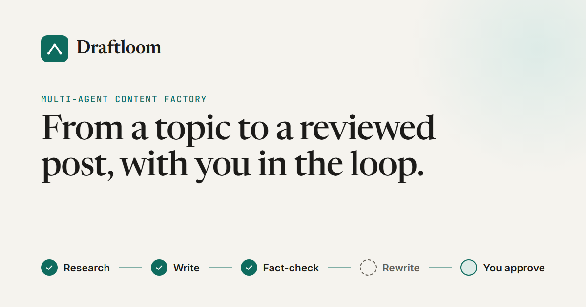

# Draftloom: Multi-Agent Content Factory



Type a topic. A team of AI agents researches it, writes a blog post and fact-checks it. Then the run **pauses and waits for a human**: you edit the draft and approve it (published) or reject it (saved as a draft). Nothing is published until you say so.

Built with **LangGraph (JS)** for the agent graph and **Next.js 16** for the UI, with **Supabase Postgres** storing both the posts and the paused runs.

## How it works

```
START → supervisor → researcher → supervisor → writer → supervisor → critic → supervisor
      → rewriter (only if the critic found factual errors) → supervisor
      → approval  ⏸  pauses for you  → supervisor → publisher → END
```

- **Hub and spoke.** Every agent returns to a rule-based supervisor. The supervisor is a pure function of the state (no LLM): it looks at what is missing and routes to the next agent.
- **Researcher:** an LLM writes 3 search queries, Tavily runs them in parallel, and the results are turned into notes with real source URLs only.
- **Writer:** writes the post from the notes only, then a `## Sources` list is appended in code.
- **Critic:** checks the draft against the notes for **factual errors only** (style notes never block). It passes when there are no factual errors.
- **Rewriter:** runs **at most once**, only if the critic failed the draft.
- **Approval:** calls LangGraph's `interrupt()`. The run is checkpointed in Postgres and the stream ends. You can close the tab, restart the server, and come back later.
- **Publisher:** saves one row in the `posts` table (`published` or `draft`), keyed on the run's `thread_id`, so retries never create duplicates.

## Features

- **Live progress** over Server-Sent Events: each agent ticks off as it finishes.
- **Review screen:** editable draft (Edit / Preview), the critic's score, factual issues and style notes, then Approve or Reject.
- **Resumable runs:** the run id lives in the URL (`/?run=<id>`). A refresh or a server restart restores the exact screen from the checkpoint. Failed or interrupted runs can continue from the failed step without redoing finished work.
- **Published / Drafts** lists with a reader view and delete.
- **Light and dark theme**, and a separate app-style layout on phones (bottom tab bar, bottom sheets).
- **Private by default:** the whole site (pages and API) sits behind a passcode, with a per-IP limit on wrong attempts.

## Tech stack

| Area | Tools |
|---|---|
| Agents | `@langchain/langgraph`, `@langchain/openai`, `@langchain/tavily`, Zod structured output |
| Persistence | Supabase Postgres: `posts` table + LangGraph `PostgresSaver` checkpoints (schema `langgraph`) |
| App | Next.js 16 (App Router), React 19, Tailwind CSS 4, `react-markdown` |
| Tracing | LangSmith (optional) |

## Getting started

### 1. Install

```bash
npm install
```

### 2. Environment variables

Copy `.env.example` to `.env.local` and fill it in. All of these are **server-only**: never prefix them with `NEXT_PUBLIC_`.

| Variable | What it is |
|---|---|
| `OPENAI_API_KEY`, `OPENAI_MODEL` | The model used by every agent (default `gpt-4o-mini`) |
| `TAVILY_API_KEY` | Web search for the researcher |
| `SUPABASE_URL`, `SUPABASE_SERVICE_ROLE_KEY` | Server access to the `posts` and `unlock_attempts` tables |
| `SUPABASE_DB_URL` | Postgres connection string for the checkpointer. Use the **session pooler (port 5432)**, not the transaction pooler (6543). |
| `SITE_PASSCODE` | Passcode for the whole site. Not set: open in local dev, fully locked in production. |
| `LANGSMITH_*` | Optional tracing |
| `GROQ_API_KEY`, `GROQ_MODEL` | Currently unused (Groq is disabled in `src/graph/model.ts`) |

### 3. Database

Create the `posts` table in the Supabase SQL editor (the columns the publisher and the lists use):

```sql
create table public.posts (
  id uuid primary key default gen_random_uuid(),
  thread_id text unique not null,
  title text not null,
  content text not null,
  research_sources jsonb not null default '[]',
  status text not null check (status in ('published', 'draft')),
  published_at timestamptz,
  created_at timestamptz not null default now()
);
-- RLS on with no policies: only the service-role key (the server) can read or write it.
alter table public.posts enable row level security;
```

Then create the checkpoint tables and the passcode rate-limit table (both scripts are safe to run again):

```bash
npx tsx --env-file=.env.local scripts/setup-checkpointer.ts
npx tsx --env-file=.env.local scripts/setup-rate-limit.ts
```

### 4. Run

```bash
npm run dev
```

Open http://localhost:3000.

You can also run the graph from the terminal, without the UI:

```bash
npx tsx --env-file=.env.local scripts/run-graph.ts "your topic" approve   # or: reject
```

## API

Every route except `/api/unlock` needs the unlock cookie (see "Passcode lock" below).

| Route | What it does |
|---|---|
| `POST /api/runs` `{ topic }` | Starts a run. SSE stream: `thread`, `node`…, then `interrupt` (paused for review) or `error` |
| `GET /api/runs/[id]` | Run status for restoring the UI: `paused`, `failed`, `stalled`, `done` or `not_found` |
| `POST /api/runs/[id]/review` `{ action, editedDraft? }` | Approve or reject a paused run. SSE: `node`…, then `done` or `error`. Returns 409 if the run isn't waiting for a review |
| `POST /api/runs/[id]/continue` | Retries a failed or interrupted run from its last checkpoint |
| `GET /api/posts?status=published\|draft` | Lists posts, newest first |
| `DELETE /api/posts/[id]` | Deletes a post and its run's checkpoints |
| `POST /api/unlock` `{ passcode }` | Sets the unlock cookie |

## Project structure

```
src/
  graph/         LangGraph state, supervisor, agents, checkpointer
  server/        Server-only helpers: SSE, run status, posts, passcode, rate limit
  app/           Pages (/, /published, /drafts, /unlock) and API routes
  components/    UI (run flow, pipeline, review, post lists, dialogs)
  lib/           Shared types, SSE client parser, text helpers
  proxy.ts       Passcode gate for every request
scripts/         CLI runners, checks and setup scripts
design/          UI design spec and mockups
```
